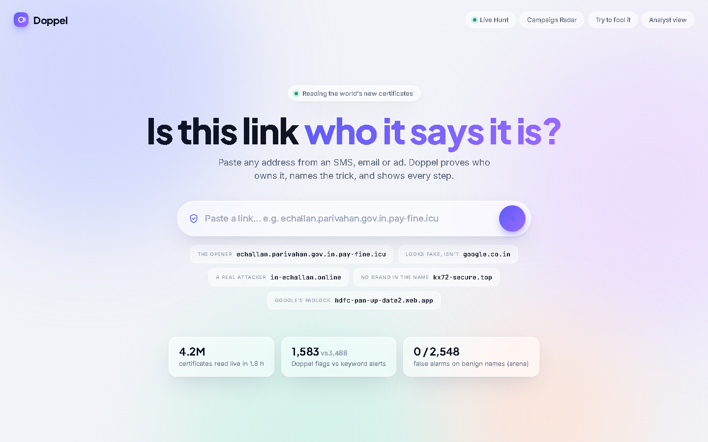
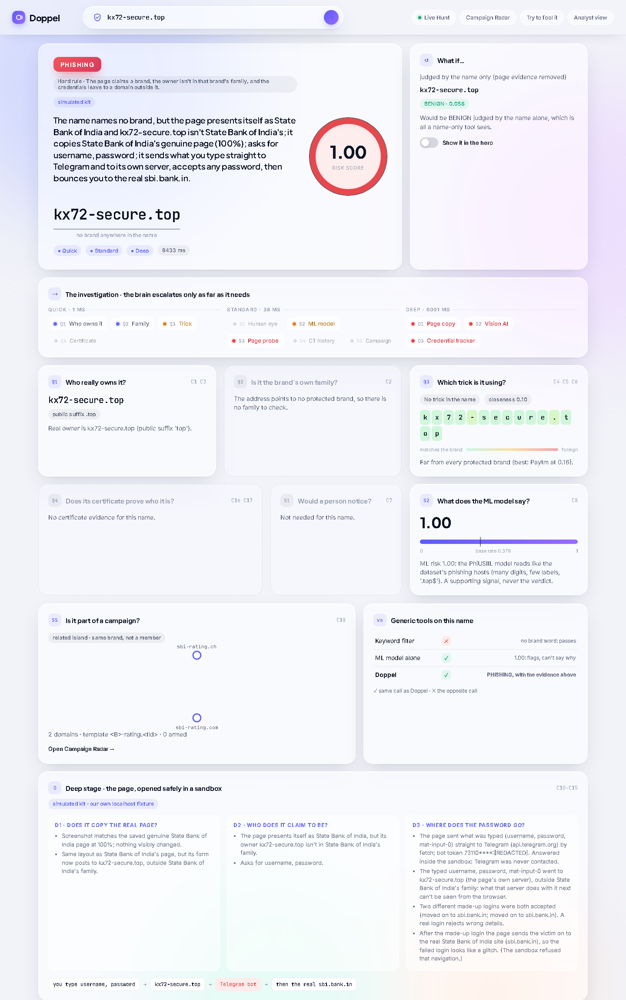
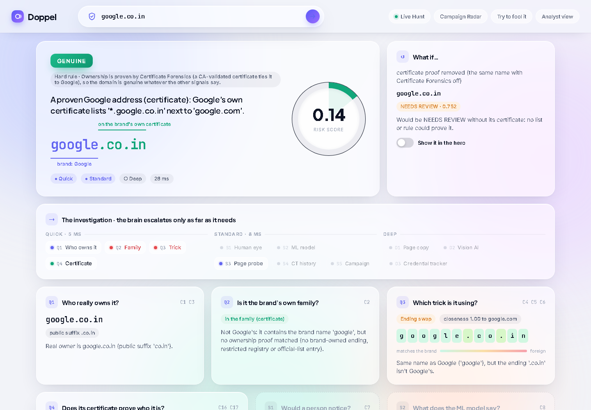

# Doppel: phishing domains, proven, not guessed

> **Is this link who it says it is?** Doppel reads an address the way a registry does, proves who owns it, names the trick, and shows every step it took. It also watches every new HTTPS certificate on the planet to catch look-alikes before they go live.

Built for the HackOUTR hackathon, problem statement **PS-08: Phishing Domain Detection**.

<p align="center"></p>

---

## Why Doppel

Most phishing detectors are a list or a score. Lists are always late, and a score can't explain itself. Both break on the cases that matter:

| Case | Keyword filter | Levenshtein | ML model | "Padlock = safe" | **Doppel** |
|---|---|---|---|---|---|
| `echallan.parivahan.gov.in.pay-fine.icu` (fake e-Challan page) | flags | misses | flags, can't say why | misses | **PHISHING**: the real owner is `pay-fine.icu`, and the page sends card + OTP away |
| `google.co.in` (Google's own site) | false alarm | false alarm | passes | passes | **GENUINE**: Google's own certificate lists it next to `google.com` |
| `in-echallan.online` (a real attacker's domain) | flags | misses | flags | misses | **NEEDS REVIEW**: armed with certificates, 1 of 5 domains from the same operator |
| `kx72-secure.top` (no brand in the name) | misses | misses | flags, can't say who | misses | **PHISHING**: copies SBI's page, sends passwords to a Telegram bot |

**The reframe:** everyone treats phishing detection as *classifying a string*. It's really *proving ownership*. A name can only borrow trust; a registry, a brand-owned TLD, or a CA-signed certificate can prove it.

---

## How it works

A deterministic **central brain** (a policy, not an LLM) sends each name through three stages. It escalates only while the evidence is still unresolved, and every step is recorded as evidence that can be replayed.

```
            ┌──────────── QUICK (ms) ────────────┐   ┌──────── STANDARD ────────┐   ┌────────── DEEP (sandbox) ──────────┐
 domain ──▶ │ Q1 Address Reader   who owns it?   │──▶│ S1 Human-eye renderer    │──▶│ D1 Page Inspector  copy of a real  │──▶ verdict
            │ Q2 Family Verifier  brand's own?   │   │ S2 Risk model (ML)       │   │    page? form target changed?      │    + what-if
            │ Q3 Trick Detector   which trick?   │   │ S3 Page probe            │   │ D2 Vision AI  who does it claim?   │    + case file
            │ Q4 Certificate Forensics (CT/SAN)  │   │ S4 CT history (armed?)   │   │ D3 Credential Tracker  where does  │
            └────────────────────────────────────┘   │ S5 Campaign Radar        │   │    the password go?                │
                                                      └──────────────────────────┘   └────────────────────────────────────┘
```

**Verdicts:** `GENUINE` · `BENIGN` · `NEEDS REVIEW` · `SLEEPER` · `PHISHING`. A suspicious *name* alone never convicts: real brands own odd names too. Page evidence or a listing is needed for PHISHING.

### Signature features

- **Certificate Forensics (C16/C17):** a CA must validate control of every name on a certificate, so a shared certificate is signed proof of one owner. Doppel uses it to prove genuine sites that no list knows about, and refuses it where it proves nothing (e.g. a `*.web.app` wildcard covers any tenant on Firebase).
- **Live Hunt:** reads the public Certificate Transparency stream (≈ 760 names/s on one laptop), judges every name, and raises an **ARMED** alarm when a watched look-alike gets its first certificate.
- **Campaign Radar (C18):** links flagged domains by naming template, certificate recipe and timing. It found the e-Challan operator (5 domains, 3 certificates within 26 minutes) automatically, from 2.3M raw newly registered names.
- **Deep stage, safely:** pages are opened only in a sandboxed browser on **our own local fixture kits**. Doppel never visits a real suspect. It detects cloned pages, foreign form targets, Telegram exfiltration and "accepts any password" kits.
- **Explainable by construction:** every verdict carries evidence ids, a counterfactual ("what if…"), and an EN/हिंदी case file in which every sentence must cite evidence.

### Measured (on our benchmarks)

- **0 / 2,548** false alarms on benign names in the trick arena.
- 97 / 98 genuine names proven GENUINE; India Post 25/25, ICICI 7/7, Income Tax 6/6, HDFC 11/11 on a public phishing list.
- ~3,500 names/s on one CPU core (Quick + Standard).
- Live: 4.2M certificates read in 1.8 h → **1,583 Doppel flags vs 3,488 keyword alerts**.
- A **no-degradation gate** (`bench/regress.py`) blocks any change that lowers a number.

Risk is a ranking score, not a calibrated probability.

## What you see

Type a name and press Enter. The search bar glides up and "the space" assembles: the verdict with the domain annotated, the pipeline lighting up stage by stage, then one card per check that ran. Checks the brain didn't need are shown faded, with its reason.

| A fake with no brand in its name → **PHISHING** | Google's own site → **GENUINE**, by certificate |
|---|---|
|  |  |

---

## Repository layout

```
doppel/          the engine
  address/       Address Reader (Public Suffix List, owner, hidden letters)
  family/        Family Verifier + family auto-discovery from certificates
  tricks/        Trick Detector (16 tricks, glyph-cost edit distance)
  certs/         Certificate Forensics, CT cache, SAN links
  perception/    human-eye renderer (how a phone shows the link)
  risk/          ML risk model (PhiUSIIL-trained, calibrated)
  deep/          sandboxed browser, Page Inspector, Vision AI, Credential Tracker
  campaign/      Campaign Radar (templates, certificate recipes, islands)
  live/          Live Hunt collector, catch store, lead-time clock, replay
  brain/         the central policy, fusion, hard rules, counterfactuals
  casefile/      grounded EN/HI case files
  api/           FastAPI app (also serves the built UI)
  cli.py         `python -m doppel.cli …`
ui/              React + Vite UI: the Presenter view and the Analyst console
contracts/       JSON schemas for verdicts and the brand registry, plus examples
data/            brand registry, certificate cache, campaign snapshot (small files only)
bench/           benchmarks and the no-degradation gate
demo/            local fixture pages config + the finale smoke check
scripts/         data fetch / profiling, live-collector helpers
tests/           Python test suite
```

---

## Run it

**Requirements:** Python 3.11 (3.12 works; 3.14 has no scikit-image wheel yet), Node 20.19+.

```bash
# 1. engine
python -m venv .venv
.venv/Scripts/activate          # Windows  (source .venv/bin/activate on macOS/Linux)
pip install -e ".[api,tricks,risk,deep,certs,llm,live,campaign,dev]"
python -m playwright install chromium    # the Deep stage sandbox browser

# 1b. data (pinned, SHA-256 checked) + the local fixture pages for the Deep stage
python scripts/data/fetch.py
python scripts/data/snapshot_genuine.py  # saves the genuine brand pages the kits are cloned from
python -m doppel.deep.pages              # generates the fixture kits (gitignored)

# 2. optional keys: copy the template and fill in your own
cp .env.example .env            # Gemini (vision), Groq (case files), SSLMate (CT lookups)

# 3. UI
cd ui && npm install && npm run build && cd ..

# 4. serve the API + UI
python -m doppel.cli serve      # open http://127.0.0.1:8000/
```

The Quick and Standard stages need no data download and no keys: `pip install -e ".[api,tricks,certs]"` and `python -m doppel.cli scan <name>` is enough to try it.

Doppel runs without any keys: vision and narration fall back to cached results and templates, and certificate checks use the bundled CT cache. Set `DOPPEL_OFFLINE=1` to never touch the network.

### Useful commands

```bash
python -m doppel.cli scan sbi-secure-login.com google.co.in   # judge names (json/csv/html/blocklist)
python -m doppel.cli cert-diff google.co.in                   # the same name with certificates off → on
python -m doppel.cli report in-echallan.online --lang hi      # case file in Hindi
python -m doppel.cli campaigns                                # rebuild Campaign Radar
python -m doppel.cli live run                                 # the live CT collector (stop: live stop)
python demo/finale/smoke.py                                   # 23 pinned stage cases
python bench/regress.py                                       # the no-degradation gate
pytest -q                                                     # Python tests
cd ui && npm test                                             # UI tests
```

UI deep links: `/` Presenter view · `/?d=<domain>` open one result · `/?tab=explore` Analyst console · `/?tab=live` Live Hunt · `/?tab=radar` Campaign Radar · `/?tab=fool` Try to fool it.

---

## Data and honesty

- Large datasets (PhiUSIIL, newly registered domains, Phishing.Database, genuine page snapshots) are **not** in this repo. `scripts/data/fetch.py` downloads them, pinned and SHA-256-checked.
- Fixture phishing pages are made by us, served only inside the sandbox, and labelled **simulated kit** in the UI. No real credentials are ever used.
- Live catches are called "imitates *brand*", never "phishing", unless a public list or page evidence says so.
- Third-party data and code are credited in [CREDITS.md](CREDITS.md).

## Tech stack

Python 3.11 · FastAPI · Playwright (sandboxed Chromium) · scikit-learn (logistic regression, calibrated) · scikit-image (SSIM) · NetworkX · websockets (CT stream) · Gemini (page vision) · Groq (case-file narration) · React 18 + Vite + Tailwind 4 · Vitest · pytest.

## License

Code for hackathon evaluation. Third-party components keep their own licences (see CREDITS.md).
